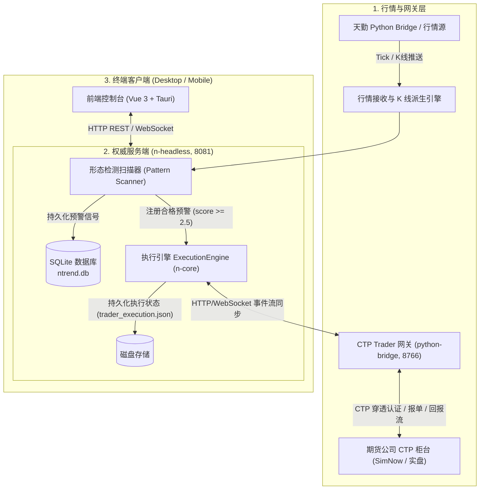
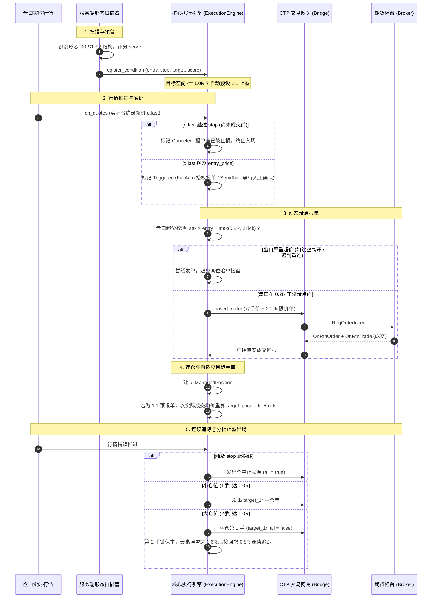
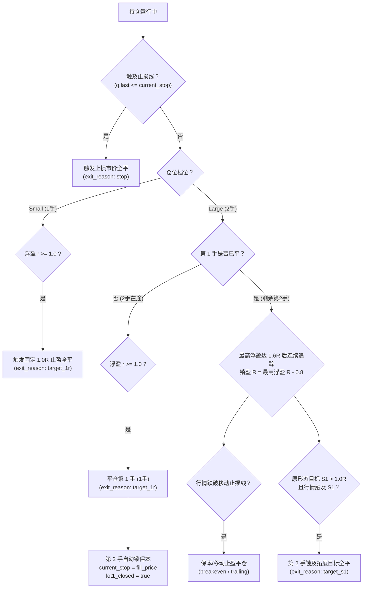

# ntrend 量化实盘自动交易执行全流程详解

本文档全面梳理 **ntrend** 量化系统从「形态检测预警」到「真实 CTP 柜台报单、持仓管理、动态止损止盈与复盘流水归档」的端到端全流程。

---

## 目录
1. [系统总体架构与组件拓扑](#一系统总体架构与组件拓扑)
2. [量化交易全生命周期时序图](#二量化交易全生命周期时序图)
3. [核心交易链路详解](#三核心交易链路详解)
   - [第一阶段：形态扫描与预警生成](#1-第一阶段形态扫描与预警生成)
   - [第二阶段：条件单注册与自适应目标预设](#2-第二阶段条件单注册与自适应目标预设)
   - [第三阶段：行情监控与触价触发](#3-第三阶段行情监控与触价触发)
   - [第四阶段：执行报单与动态滑点保护 (0.2R防追高)](#4-第四阶段执行报单与动态滑点保护-02r防追高)
   - [第五阶段：成交回报驱动与持仓建立](#5-第五阶段成交回报驱动与持仓建立)
   - [第六阶段：多级分批出场与连续追踪止盈](#6-第六阶段多级分批出场与连续追踪止盈)
   - [第七阶段：流水结算与统计分析](#7-第七阶段流水结算与统计分析)
4. [风控安全边界与异常防御机制](#四风控安全边界与异常防御机制)
5. [常见问题与典型场景问答](#五常见问题与典型场景问答)

---

## 一、系统总体架构与组件拓扑

### 核心组件职责：
- **行情网关 (TQ Bridge)**：接收主力合约及指数连续 Tick 行情，常驻维护与派生 15m/5m 等多周期 K 线。
- **扫描器 (Scanner)**：依据趋势波段模型自动识别 $S_0$（启动点）、$S_1$（结构极值目标）、$S_2$（回调确认点），计算突破入场点、止损位与质量评分。
- **执行引擎 (ExecutionEngine)**：负责条件单生命周期管理、交易日换日、柜台状态核对、滑点控制、分级止损止盈、阶梯移动追踪锁盈以及真实成交流水记录。
- **CTP 桥接 (python-bridge)**：封装 CThostFtdcTraderApi，负责穿透式认证、会话维护、自动重连与柜台订单查询/推送。

---

## 二、量化交易全生命周期时序图

---

## 三、核心交易链路详解

### 1. 第一阶段：形态扫描与预警生成
- **触发时机**：每根 15 分钟 K 线走完收盘后（例如 10:15, 11:30, 15:00, 21:15 等），系统自动执行多品种扫描。
- **核心数据结构**：
  - **$S_0$ 点**：波段起涨点/起跌点；
  - **$S_1$ 点**：前期结构高点（做多目标位）或前期结构低点（做空目标位）；
  - **$S_2$ 点**：回调确认点；
  - **入场触发价 (`entry`)**：突破 $S_2$ 之后确认突破形态的入场临界线；
  - **初始止损价 (`stop`)**：防守基准点（通常为 $S_2$ 极值点）；
  - **止损风险空间 (`risk`)**：$\text{risk} = |\text{entry} - \text{stop}|$；
  - **形态质量评分 (`entry_score`)**：根据 A 浪幅度、B 浪回调质量、均线形态、大周期共振等多维度综合打分（0.0 ~ 5.0 分）。
- **准入门槛**：只有评分 $\ge 2.5$ 且属于受关注/自选交易品种的预警信号，才会被推送到执行引擎。

---

### 2. 第二阶段：条件单注册与自适应目标预设
预警推送到执行引擎后，执行 [`register_condition`](file:///h:/WorkSpace2/Rust/RustRover/ntrend/crates/n-core/src/trader/execution.rs#L450)：

#### ① 仓位规模分级 (Tier)
- **大仓位 (`PositionTier::Large`)**：评分 $\ge 3.5$ 分，默认开仓 **2 手**，采用“首手 1.0R 止盈 + 次手保本及连续追踪”；
- **小仓位 (`PositionTier::Small`)**：评分在 $2.5 \sim 3.5$ 之间，默认开仓 **1 手**，采用“1.0R 固定止盈”。

#### ② 目标空间自适应 1:1 预设机制
为防止“入场突破点距离前高/前低 $S_1$ 空间过窄（甚至 $S_1$ 在突破点下方）导致刚入场就被秒平”，系统自动测算理论空间：
$$\text{target\_space} = \begin{cases} \text{target} - \text{entry}, & \text{做多} \\ \text{entry} - \text{target}, & \text{做空} \end{cases}$$
- **若 $\text{target\_space} \le \text{risk}$（即形态初始盈亏比 $RR \le 1.0$）**：
  - 自动舍弃原形态 $S_1$ 目标点位，强制将止盈预设为标准的 **1:1 盈亏比（$1.0R$）**：
    $$\text{effective\_target} = \text{entry} \pm \text{risk}$$
  - 条件单备注注明：`目标空间<1R(S1:xxx)，止盈预设1:1`。
- **若 $\text{target\_space} > \text{risk}$（即 $RR > 1.0$）**：
  - 保持原形态 $S_1$ 拓展目标不变。

---

### 3. 第三阶段：行情监控与触价触发
- **合约映射**：系统将抽象的主连指数代码（如 `FG0`, `RB0`）自动解析映射为交易所当日实际主力交割合约（如 `FG701`, `rb2701`），并订阅其高速 Tick 盘口行情。
- **触价判定**：
  - 做多：$\text{q.last} \ge \text{cond.entry\_price}$；
  - 做空：$\text{q.last} \le \text{cond.entry\_price}$。
- **防越界防护**：
  - 若在报单成交前，行情已经跌破/涨破止损价（$\text{stop\_hit}$），系统立即标记为 `Canceled`（“报单前行情已越过止损，终止本次入场”），绝不在破止损后还逆向开仓。
- **时效过期机制**：
  - 条件单从预警生成开始，最多等待 **12 根 15 分钟 K 线（即 3 个交易小时）**；若超过等待期未触发，自动转为 `Expired`（失效过期）。

---

### 4. 第四阶段：执行报单与动态滑点保护 (0.2R防追高)

当条件单触发且进入报单流程（全自动或半自动确认后）时，执行引擎在发出 CTP 委托前执行**严格的动态滑点拦截**：

#### ① 动态滑点公式：
$$\text{max\_entry\_slippage} = \max\Big(\text{risk} \times 0.2,\;\; 2 \times \text{Tick}\Big)$$
- **买入允许最高限价**：$\text{entry\_price} + \text{max\_entry\_slippage}$；
- **卖出允许最低限价**：$\text{entry\_price} - \text{max\_entry\_slippage}$。

#### ② 盘口超价防护（防高位追单接盘）：
- 系统取当前盘口对手价（买入看卖一价 Ask1，卖出看买一价 Bid1）；
- **若 $\text{market\_price} > \text{最高允许价}$（做多）或 $< \text{最低允许价}$（做空）**：
  - 系统**严禁直接发单**，更**不会以压低价格挂买不到的死单**；
  - 条件单状态保持就绪，备注更新为：`盘口xxx超入场滑点限制(上限xxx)，暂缓报单`；
  - 若行情随后正常回踩落入安全区间，系统自动恢复发单；若持续单边飞走直至超时，安全过期。

#### ③ 报单方式：对手价超价限价单
- 确认在安全滑点范围内后，系统以“卖一价 + 2 Tick”发出买入限价单（或“买一价 - 2 Tick”发出卖出限价单）；
- 交易所撮合机制会保证以**最优价格成交**；
- 订单发出后启动 **3 秒定时器**：若 3 秒内未完全成交，系统自动撤单重报，直至完全成交。

---

### 5. 第五阶段：成交回报驱动与持仓建立
- **回报驱动原则**：执行引擎绝不假设发单即成交，持仓建立和数量更新**完全由柜台 OnRtnTrade 真实回报驱动**。
- **开仓滑点自适应重算**：
  - 当持仓建立时，若该单属于 1:1 预设单，引擎以**实际成交均价 (`fill_price`)** 和**实际止损距离**实时重新校准持仓目标：
    $$\text{pos.target\_price} = \text{pos.fill\_price} \pm \text{pos.risk}$$
  - 确保即使开仓发生了 1~2 个 Tick 的合理滑点，出场目标依然精准落在实际持仓成本的 $1.0R$ 线上。

---

### 6. 第六阶段：多级分批出场与连续追踪止盈

持仓建立后，执行引擎在每个 Tick 行情更新时进行出场研判：

#### 出场优先级细则：
1. **硬止损 (`stop`) 具有绝对最高优先级**：一旦跌破初始止损点，无论处于任何阶段，全仓立刻清仓止损。
2. **大仓位第 1 手 1.0R 保护**：只要达到 $1.0R$，第 1 手必须落袋为安，并立刻将剩余 1 手的防守价拉升至开仓保本价。
3. **彻底隔离 S1 误平漏洞**：
   - 删除了旧版在顶层无保护的 `target_s1` 全平判断；
   - 仅当 $S_1$ 目标位盈亏比大于 1.0R，且第 1 手已经锁定利润后，第 2 手才允许按 `target_s1` 止盈；
   - 若目标空间原本就不足 1.0R，第 2 手完全交由连续移动止损保护。
4. **无跟随时效退出 (`no_follow` / `time_exit`)**：
   - 持仓达到指定 K 线数（如 6 根）但最高盈利从未突破 $+0.3R$，判定动能衰竭平仓 (`no_follow`)；
   - 达到最大持仓周期（如 48 根 K 线）强制时间平仓 (`time_exit`)。

#### 方案 B：连续追踪（2026-10-20）

- 第 1 手真实平仓完成后，第 2 手先按开仓成本线保本；最高浮盈未到 1.6R 时不提前追踪。
- 最高浮盈达到 1.6R 后，每个有效实际合约行情更新止损：锁盈 R = 最高浮盈 R − 0.8R，不再按 0.8R 向下取整。
- 多单止损 = 开仓价 + 锁盈 R × 初始风险点数；空单止损 = 开仓价 − 锁盈 R × 初始风险点数。止损只收紧，恢复旧持仓时也不放宽已保存止损。
- 例如 EG 开仓 4978、风险 55.295 点、最高 5127，理论追踪线为 5082.764。触发后仍按现有盘口报单流程成交，不保证按止损线成交。
- 实盘执行与盘口影子推演共用该规则。前瞻对比版本为 `paired-quote-v2-continuous-08r`，旧版未结束观察停止续算并标记缺数据，旧版已结束记录保留。
- 历史信号复盘与旧研究回测中的阶梯口径不随本次实盘改动重算。

---

### 7. 第七阶段：流水结算与统计分析
- 每一笔平仓成交回报到达时，系统在数据库中生成一条包含完整生命周期的真实交易记录 (`TradeRecord`)：
  - 开平时间与耗时（K 线数）；
  - 开仓均价、平仓均价；
  - 最终实现盈亏点数 (`realized_pnl_pts`)；
  - **最终实现盈亏金额 (`realized_pnl_amount`)**：$\text{点数} \times \text{合约乘数} \times \text{手数}$；
  - 最终实现的 R 乘数 (`r_multiple`)；
  - 最大有利浮盈 (`max_mfe_r`) 与最大不利浮亏 (`max_mae_r`)；
  - 平仓原因归因分类（`target_1r`, `stop`, `trailing`, `breakeven`, `target_s1`, `no_follow` 等）。
- 系统前端在“量化实盘”面板即时呈现资金曲线、胜率、盈亏比与出场原因拆解。

---

## 四、风控安全边界与异常防御机制

| 风险场景 | 系统防御机制 | 代码防护位置 |
| :--- | :--- | :--- |
| **盘中极端行情跳空高开 / 涨停** | 最大允许滑点保护：$\max(0.2R, 2\text{Ticks})$，超价立即拦截报单，绝不追高 | `crates/n-core/src/trader/execution.rs` (`drive()`) |
| **柜台断线 / 盘后换日重连** | 柜台状态机硬隔离：`ready=false` 时严禁报单；重连后若市价已偏离原入场点超 0.2R，安全跳过 | `crates/n-core/src/trader/execution.rs` (`on_quotes`) |
| **开仓前行情已破止损** | 在发单前实时校验：`q.last <= stop` 则直接将条件单标记为 `Canceled` 废弃 | `crates/n-core/src/trader/execution.rs` (`on_quotes`) |
| **报单超时 / 盘口拉升挂空** | 3 秒未成交自动发起撤单确认，撤单成功后再根据最新盘口改价重报 | `crates/n-core/src/trader/execution.rs` (`drive()`) |
| **目标空间过窄秒平风险** | 目标空间 $\le 1.0R$ 自动预设 1:1 止盈；开仓成交根据真实均价自适应调整目标点 | `crates/n-core/src/trader/execution.rs` (`register_condition` & `on_trade`) |
| **大仓位一次性全平** | 1.0R 仅平第 1 手 (`all=false`)；第 2 手锁保本，1.6R 起连续追踪；移除顶层裸露的 `target_s1` | `crates/n-core/src/trader/execution.rs` (`on_quotes`) |
| **单日累计巨额亏损** | 单日累计浮亏/亏损达 `daily_loss_limit_r`（默认 3.0R）时，执行引擎启动全天熔断，停止新开仓 | `crates/n-core/src/trader/execution.rs` (`drive()`) |

---

## 五、常见问题与典型场景问答

### Q1: 为什么有时候实盘里成交了，但在前端预警列表里“看不到对应的信号记录”？
- **A**：主要有三个原因：
  1. **日盘预警，夜盘成交**：例如 15:00 收盘 K 线生成的预警，信号时间戳记为 `15:00:00`；而成交发生在夜盘 21:42，如果在列表里按 21:42 附近的时间找，是找不到该预警的。
  2. **信号已结案归档**：前端“实时信号/活跃预警”面板默认只展示等待触发或持仓中的单子。一旦信号在 K 线层面走完生命周期（判定止盈或止损变为 `closed`），会自动移入“复盘统计 / 历史明细”中。
  3. **合约代码差异**：预警扫描的是主连指数代码（如 `FG0`, `RB0`），实盘成交展示的是交割主力合约代码（如 `FG701`, `rb2701`）。

### Q2: 为什么以前螺纹钢做多 2 手一次性全部平仓了？
- **A**：旧版代码在阶梯移动止损逻辑外，有一段硬编码的顶层判定：`if (q.last >= target) { latch_exit(..., all: true); }`。当行情刚触及目标时，该逻辑不分仓位手数、直接强制全平（`all = true`）。
- **当前现状**：该漏洞已彻底修复，现在严格执行“首手 1.0R 止盈 + 次手保本追踪”，次手绝不会在 S1 处被误平。

### Q3: 为什么开仓不是挂固定价格限价单，而是市价超价吃单？
- **A**：因为形态交易属于突破动量策略。如果行情突破 860 时挂 860 的买单，在行情快速上冲时买单会挂在后排完全买不到导致踏空。因此系统采用“当前盘口对手价 + 2 个 Tick”的超价单保证成交。同时，我们最新加入的“$\max(0.2R, 2\text{Ticks})$”入场动态滑点保护，从根本上防止了因断线重连或跳空高开导致的高位盲目追单。
