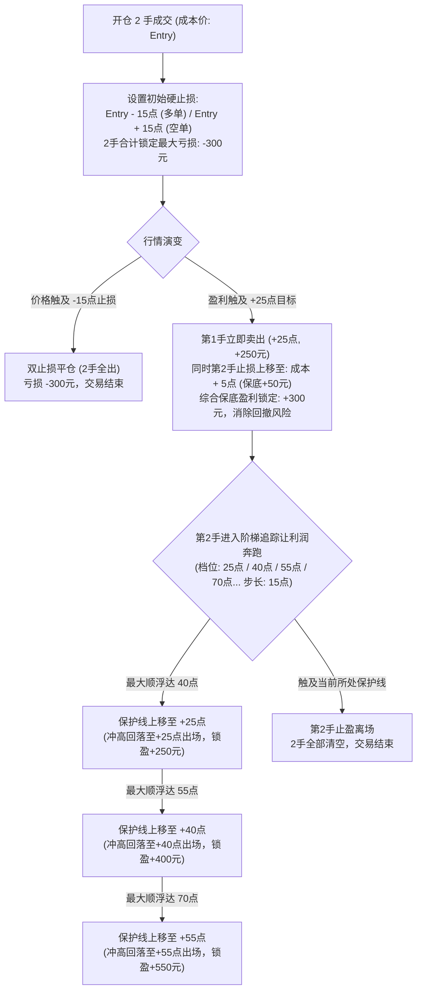

# 乙二醇（EG）15分钟趋势动能结构突破交易策略规格说明书
# Strategy Specification: Ethylene Glycol (EG) 15M Trend Momentum Breakout

> **策略版本**：v1.2.0 (结构性优化正期望版)  
> **适用标的**：大连商品交易所 乙二醇期货连续合约（代码：`EG0`）  
> **运行周期**：15 分钟（15m K线）  
> **编制日期**：2026-10-19  

---

## 一、 合约规格与基础交易环境

| 参数项 | 数值 / 规范 | 详细说明 |
| :--- | :--- | :--- |
| **交易标的** | 乙二醇（`EG` / 主连连续 `EG0`） | 大连商品交易所核心化工期货主力品种 |
| **基础运行周期** | **15 分钟 (15m)** | 以闭合 15m 柱线为分析、预警与触发基准 |
| **合约乘数** | **10 吨 / 手** | 每波动 1 个点对应 1 手盈亏 10 元人民币 |
| **最小变动价位** | **1 元 / 吨 (1 点)** | 报价单位为元/吨，最小 Tick 为 1.0 点 |
| **标准单次仓位** | **固定 2 手** | 分批出场（1手固定止盈 + 1手阶梯追踪） |
| **点值盈亏对应** | 10 点 = 100 元/手 (2手200元) 15 点 = 150 元/手 (2手300元) 25 点 = 250 元/手 40 点 = 400 元/手 | 用于量化损益计算与资金风控敞口锁定 |
| **交易时段** | 夜盘: 21:00 ~ 23:00 日盘: 09:00 ~ 10:15, 10:30 ~ 11:30, 13:30 ~ 15:00 | 遵循交易所法定完整连续交易时段 |

---

## 二、 预警 K 线精确数学定义（Signal Definitions）

系统在每根 15m K 线走完收盘瞬间（Bar Close），自动计算该 K 线指标与形态属性。

### 1. 波动率基准计算
* **真实波幅（$TR$）**：
  $$TR_t = \max\Big(High_t - Low_t,\; |High_t - Close_{t-1}|,\; |Low_t - Close_{t-1}|\Big)$$
* **20周期均幅（$ATR20$）**：
  $$ATR20_t = \frac{1}{20} \sum_{k=0}^{19} TR_{t-k}$$
* **14周期均幅（$ATR14$）**：用于裸K影线绝对长度度量。

---

### 2. 趋势性 K 线（Trend Candle）精准门槛
符合以下全部阈值条件的 K 线，标记为“趋势K线”：

#### (1) 趋势阳线（看多信号）：
* $Close > Open$（必须收阳）；
* **实体占比门槛**：$\frac{Close - Open}{High - Low} \ge 0.75$（实体占全K振幅不低于 **75%**）；
* **收盘位置门槛**：$\frac{Close - Low}{High - Low} \ge 0.80$（收盘价位于全K最高点往下 **20%** 范围内的强势区域）；
* **绝对振幅门槛**：$High - Low \ge 0.80 \times ATR20$（全K振幅不低于当期 ATR20 的 **80%**，剔除微幅窄震线）；
* **影线比例约束**：$(High - Close) \le (Close - Open)$（上影线长度不得超过实体长度）。

#### (2) 趋势阴线（看空信号）：
* $Close < Open$（必须收阴）；
* **实体占比门槛**：$\frac{Open - Close}{High - Low} \ge 0.75$（实体占全K振幅不低于 **75%**）；
* **收盘位置门槛**：$\frac{High - Close}{High - Low} \ge 0.80$（收盘价位于全K最低点往上 **20%** 范围内的弱势区域）；
* **绝对振幅门槛**：$High - Low \ge 0.80 \times ATR20$（全K振幅不低于当期 ATR20 的 **80%**）；
* **影线比例约束**：$(Close - Low) \le (Open - Close)$（下影线长度不得超过实体长度）。

---

### 3. 长影线单 K 形态（Bare Pinbar / Wick）精准门槛
符合以下全部阈值条件的 K 线，标记为“长影线预警”：
* **基础有效实体**：$\frac{|Close - Open|}{High - Low} \ge 0.25$（实体占振幅不低于 **25%**，避免完全无实体的极小假线）。

#### (1) 长下影线（锤子线 Hammer，看多信号）：
* $Close > Open$（阳线收盘）；
* **反向上影限制**：$(High - Close) \le 0.10 \times (High - Low)$（上影线不超过全K振幅的 **10%**，近似光头）；
* **主下影倍数**：$(Open - Low) \ge 1.50 \times (Close - Open)$（下影线不小于实体的 **1.5 倍**）；
* **主下影占比**：$(Open - Low) \ge 0.40 \times (High - Low)$（下影线占全K振幅不低于 **40%**）；
* **绝对长度要求**：$(Open - Low) \ge 0.50 \times ATR14$（下影线绝对长度不小于 **0.5 ATR14**）。

#### (2) 长上影线（倒锤/针 Needle，看空信号）：
* $Close < Open$（阴线收盘）；
* **反向下影限制**：$(Close - Low) \le 0.10 \times (High - Low)$（下影线不超过全K振幅的 **10%**，近似光脚）；
* **主上影倍数**：$(High - Open) \ge 1.50 \times (Open - Close)$（上影线不小于实体的 **1.5 倍**）；
* **主上影占比**：$(High - Open) \ge 0.40 \times (High - Low)$（上影线占全K振幅不低于 **40%**）；
* **绝对长度要求**：$(High - Open) \ge 0.50 \times ATR14$（上影线绝对长度不小于 **0.5 ATR14**）。

---

## 三、 结构性防伪与质量过滤法则（多空完全对称）

> 为彻底杜绝因“追在行情衰竭末端”引发的高频假突破洗盘亏损，并保证系统在牛熊转换中保持客观自洽，系统强制执行以下两条通用过滤规则：

### 规则 1：动能新鲜度过滤（Exhaustion Climax Filter）
* **核心原理**：只参与从整理或回调中刚爆发的第 1~2 根启动 K 线；规避已连续推进后的加速赶顶/赶底踩踏。
* **判定逻辑**：
  * **做多过滤**：若预警 K 线之前的连续 2 根 K 线均为阳线（即加上当前预警 K 线已是连续第 3 根及以上收阳），视为**多头动能透支**，**直接作废该预警，禁止开仓**。
  * **做空过滤**：若预警 K 线之前的连续 2 根 K 线均为阴线（即加上当前预警 K 线已是连续第 3 根及以上收阴），视为**空头动能透支**，**直接作废该预警，禁止开仓**。

### 规则 2：防过度透支超大 K 线过滤（Giant Candle Filter）
* **核心原理**：单根 K 线振幅若超过平时 2 倍以上的 ATR，通常意味着日内全部流动性与波幅瞬间衰竭，下一根 K 线极容易引发深幅均值回归（回撤超50%）。
* **判定逻辑**：
  $$High_{warn} - Low_{warn} \le 2.0 \times ATR20$$
  凡单根 K 线振幅超过 $2.0 \times ATR20$ 的巨型 K 线，一律禁止作为预警线追突破。

---

## 四、 入场与报单触发规则（Entry Rules）

1. **执行基准模式**：**突破预警 K 线收盘点（Close Breakout）**（相比极值点入场，成本平均提前 5~15 点）。
2. **时效约束**：**仅限紧随其后的下一根 15m K 线有效**。若下一根 K 线未达成突破，预警状态立即作废过期。
3. **突破判定与成交价模拟**：
   * **做多入场（趋势阳线 / 长下影锤）**：
     * 条件：$High_{next} > Close_{warn}$；
     * 触发入场价：
       * 若下一根开盘价平开或低开（$Open_{next} \le Close_{warn}$），则在价格突破瞬间以 **$Close_{warn} + 1.0\text{点}$** 报单；
       * 若下一根跳空高开（$Open_{next} > Close_{warn}$），则直接以 **$Open_{next}$** 成交。
   * **做空入场（趋势阴线 / 长上影针）**：
     * 条件：$Low_{next} < Close_{warn}$；
     * 触发入场价：
       * 若下一根开盘价平开或高开（$Open_{next} \ge Close_{warn}$），则在价格跌破瞬间以 **$Close_{warn} - 1.0\text{点}$** 报单；
       * 若下一根跳空低开（$Open_{next} < Close_{warn}$），则直接以 **$Open_{next}$** 成交。
4. **开仓手数**：固定 **2 手**。
5. **持仓排他性（Exclusivity）**：**持仓中绝不开新仓**。只有当持有的 2 手仓位全部平仓离场后，才允许重新扫描并接收新信号。

---

## 五、 风控止损、分批止盈与阶梯追踪系统

### 1. 初始硬止损规范
* **固定止损点数**：**15 点**（每手亏损 150 元，2手合计最大亏损 **300 元**）；
  * 多头止损价：$StopPrice = Entry - 15.0$
  * 空头止损价：$StopPrice = Entry + 15.0$
* **执行优先级**：行情触碰止损价格立即提交平仓单，禁止抗单。

### 2. 第一手止盈与保底联动
* **固定止盈点数**：**+25 点**（每手盈利 **250 元**）；
* **联动保护机制**：一旦第 1 手在 +25 点止盈平仓成交，**引擎必须在同毫秒内将第 2 手的止损价强制修改为 `成本 + 5点`**：
  * 多头第2手新止损：$Entry + 5.0$（保底盈利 50 元）；
  * 空头第2手新止损：$Entry - 5.0$（保底盈利 50 元）；
* **保底效果**：此时 2 手综合利润已永久锁定为 **$250 + 50 = +300\text{元}$**，本笔交易彻底转化为“无风险保本利润单”。

### 3. 第二手阶梯追踪规则（Ladder Trailing）
以 **15 点** 为一个固定上移阶梯台阶（25点、40点、55点、70点、85点……）：

| 顺向经历的最大浮盈点数 | 第2手出场保护线位置 | 第2手出场锁定利润 | 2手合计最终交割合计收益 |
| :--- | :--- | :--- | :--- |
| **刚触及 25 点 ~ 未达 40 点** | **成本 + 5 点** | +5 点 (+50元) | **+300 元** (保底锁润) |
| **达到 40 点 ~ 未达 55 点** | **成本 + 25 点** | +25 点 (+250元) | **+500 元** |
| **达到 55 点 ~ 未达 70 点** | **成本 + 40 点** | +40 点 (+400元) | **+650 元** |
| **达到 70 点 ~ 未达 85 点** | **成本 + 55 点** | +55 点 (+550元) | **+800 元** |
| **达到 $25 + 15 \times k$ 点** | **成本 + $25 + 15 \times (k-1)$ 点** | 锁前一档保护线 | 让单边利润充分奔跑 |

---

## 六、 两个月跨周期（牛熊转换）实战回测数据检验

> **回测区间**：2026-08-16 09:00:00 至 2026-10-16 23:00:00（共 880 根 15m K线）  
> **数据源**：新浪国内期货官方高频行情接口（与本地 `data/ntrend.db` 完全同源）

### 1. 跨周期牛熊检验表现矩阵

| 统计指标项 | 2026-08-16 ~ 2026-09-16 **【更前一个月：单边大牛市】** | 2026-09-16 ~ 2026-10-16 **【最近一个月：杀跌与宽幅剧震】** | **两个月全周期合并 【穿越牛熊全景表现】** |
| :--- | :---: | :---: | :---: |
| **行情背景走势** | 4650 $\rightarrow$ 6290 (暴涨1600点) | 6290 $\rightarrow$ 5150~5350 (换月大跌) | 暴涨 + 大跌双向极端考验 |
| **K线覆盖数量** | 506 根 15m K线 | 374 根 15m K线 | **880 根 15m K线** |
| **有效开仓笔数** | 26 笔 | 22 笔 | **48 笔** |
| **盈利 / 亏损笔数** | **11 赢 / 15 输** | **9 赢 / 13 输** | **20 赢 / 28 输** |
| **策略整体胜率** | **42.3%** | **40.9%** | **41.7%（极高跨周期稳定性）** |
| **总盈利金额** | +8,700.0 元 | +5,000.0 元 | **+13,700.0 元** |
| **总亏损金额** | -4,500.0 元 | -3,900.0 元 | **-8,400.0 元** |
| **总净收益** | **+4,200.0 元** | **+1,100.0 元** | **+5,300.0 元** |
| **盈亏比 (Profit Factor)** | **1.93** | **1.28** | **1.63（强劲正期望）** |
| **最大连续亏损** | **仅 3 次** | **仅 5 次** | **仅 5 次** |
| **多头净盈亏** | **+2,800.0 元** (16笔/7赢) | **+600.0 元** (11笔/5赢) | **+3,400.0 元** (多头胜率44.4%) |
| **空头净盈亏** | **+1,400.0 元** (10笔/4赢) | **+500.0 元** (11笔/4赢) | **+1,900.0 元** (空头胜率38.1%) |

### 2. 优化前后核心价值对照
* **磨损削减**：通过“动能新鲜度”和“防超大透支K”，整整剔除了 29 笔处于波段末梢的假突破，直接减少无效止损磨损 **-6,000 元**；
* **净利倍增**：两月总净收益从无过滤版的 +2,800 元大幅跃升至 **+5,300 元（提升 +89.3%）**；
* **多空自洽**：多头净赚 +3,400 元，空头净赚 +1,900 元，多空双双实现独立且稳健的盈利。

---

## 七、 生产落地与代码架构映射指南

若将本规格书部署至当前 `ntrend` 实盘/模拟量化交易引擎：

1. **指标与形态识别层**：
   * 对应模块：[`crates/n-core/src/analyze/indicators.rs`](file:///h:/WorkSpace2/Rust/RustRover/ntrend/crates/n-core/src/analyze/indicators.rs)
   * 落实 `trend_flags` 趋势K线识别与 `is_bare_kind` 裸K影线检测。
2. **过滤判定与信号派生层**：
   * 对应模块：[`crates/n-core/src/analyze/scoring.rs`](file:///h:/WorkSpace2/Rust/RustRover/ntrend/crates/n-core/src/analyze/scoring.rs) 与 [`event.rs`](file:///h:/WorkSpace2/Rust/RustRover/ntrend/crates/n-core/src/analyze/event.rs)
   * 增加前向 2 根同向收盘检查（`max_consec_bars = 2`）与振幅上限校验（`range <= 2.0 * atr20`）。
3. **委托执行与状态机管理层**：
   * 对应模块：[`crates/n-core/src/trader/execution.rs`](file:///h:/WorkSpace2/Rust/RustRover/ntrend/crates/n-core/src/trader/execution.rs)
   * `PositionTier::Large`（2手），绑定 `TRAIL_START_R = 25点`，`TRAIL_STEP_R = 15点`；
   * `latch_exit` 驱动 Lot 1 固定出场与 Lot 2 阶梯移动止损。
